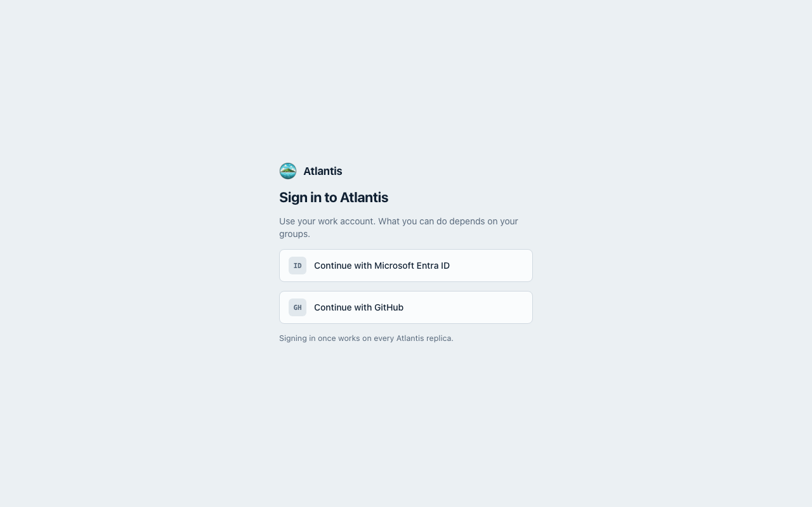
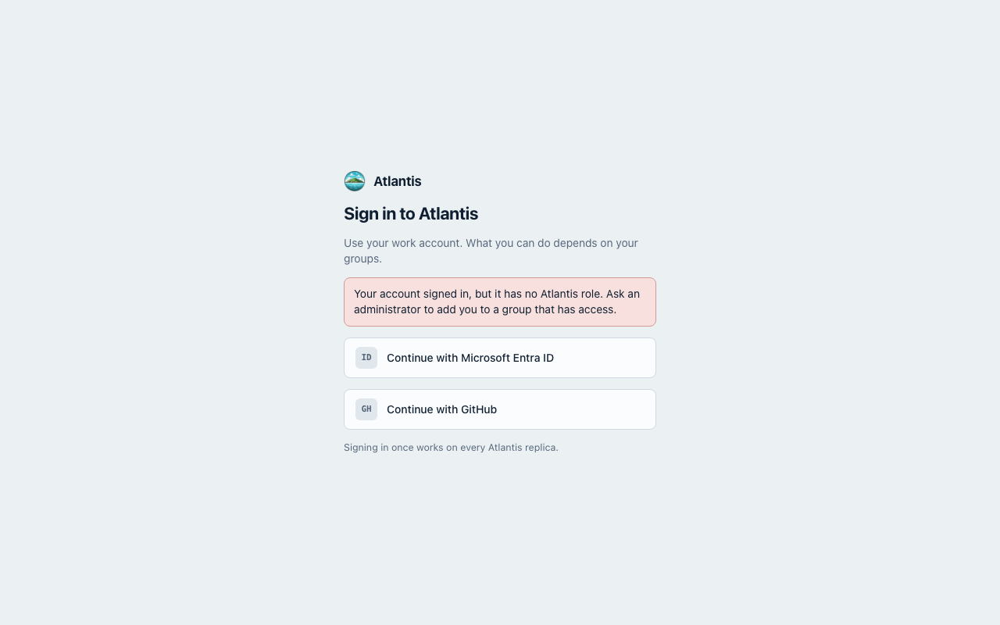
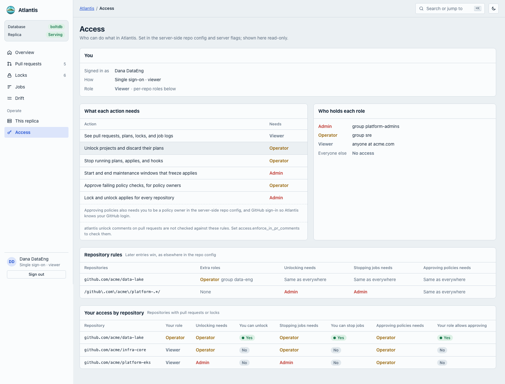
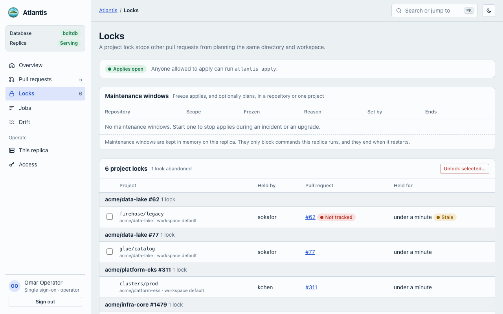

# 6. Sign in to the web UI with SSO and roles

Date: 2026-11-13

## Status

Proposed

Related issue: [#7101](https://github.com/runatlantis/atlantis/issues/7101).

## Context

The Atlantis web UI is protected only by optional basic auth: one shared username and password, off by default, with no record of who did what. Anyone who reaches the UI can discard plans, unlock projects, and lock applies for every repository. Operators who want single sign-on put an authenticating proxy in front of Atlantis, but Atlantis cannot tell users apart behind it, so it cannot limit actions by person or name them in pull request comments.

The experimental web UI behind the `web-ui` experiment adds more actions and more visible data, which makes this gap larger. Users have asked for OAuth and SSO in [#596](https://github.com/runatlantis/atlantis/issues/596) and [#4452](https://github.com/runatlantis/atlantis/issues/4452). They also want only some people, or only some teams per repository, to be able to unlock projects or lock applies, and they want the same rule to apply to `atlantis unlock` comments.

Constraints:

- Atlantis may run as several replicas behind a load balancer. Today there is no shared session store, and [ADR 0005](0005-use-durable-storage-with-one-data-model.md) is still proposed.
- Everyone who works with Atlantis already has an account on its VCS, and is usually signed in to it, often through the organization's single sign-on. Permissions for repositories already live in the VCS's organizations, teams, and groups, and Atlantis already uses GitHub teams and GitLab groups for its command allowlists. A second set of identity provider groups for Atlantis would have to be kept in step with them.
- Organizations use different identity providers: Microsoft Entra ID, Google Workspace, Okta, Keycloak, Auth0, GitLab, GitHub, and AWS IAM Identity Center are the most common. IAM Identity Center supports only SAML for application sign-in.
- Atlantis is a single binary configured through flags, environment variables, and YAML. A required extra service would be a large change for small installs.

## Decision

Atlantis will sign people in to the web UI natively, give each person a role, and decide what each role may do with an access policy that can differ per repository. This applies to the pages and the read-only JSON endpoints at `/ui`. When sign-in is on, the existing UI's pages redirect to `/ui` and its unlock and apply lock endpoints follow the same policy. The `/api` endpoints keep their API secret.

### Configuration

Sign-in and access are configured together in a new `access` section of the server-side repo config, `repos.yaml`, which operators already use to say what each repository may do. Atlantis adds no flags for providers or roles, so a change to who can sign in, or what they can do, is reviewed like any other change to that file. Secrets are never written there: each provider names the environment variable that holds its client secret, and Atlantis refuses to start if it is empty. The session secrets, `--web-session-secrets`, are the one new server setting, because every replica needs them before it reads any config. VCS providers sign in on the hosts Atlantis is already configured for.

```yaml
access:
  sign_in:
    providers:
      - type: gitlab                       # or github, gitea, oidc, google
        client_id: 0123456789abcdef
        client_secret_env: GITLAB_SIGN_IN_SECRET
        allowed_groups: [acme]
  roles:
    admin:
      - gitlab: acme/platform
```

Instead of `providers`, `sign_in.proxy` names an authenticating proxy. Atlantis validates the section at startup, including settings that don't apply to a provider's type.

### Identity sources

Operators choose one of two modes:

- **Sign-in pages.** Atlantis redirects to one or more providers. The recommended one is the VCS people already use, so roles follow the teams and groups already managed there:
  - **GitHub** is not an OIDC provider, so it has its own OAuth implementation. Organizations and teams become groups like `github:acme/sre`, and child-team membership counts for the parent team, as the existing team allowlist does.
  - **GitLab** and **Gitea** (including Forgejo) are OIDC providers on `--gitlab-hostname` and `--gitea-base-url`. GitLab groups become `gitlab:FULL/PATH`, as GitLab lists them, including subgroups of groups a person belongs to. Gitea organizations and teams become `gitea:ORG` and `gitea:ORG/TEAM`.
  - Each VCS provider requires an allowlist of organizations or groups, because anyone can create an account on github.com or gitlab.com. Only the provider of a VCS may report groups with its prefix, so no identity provider group can pose as a VCS team, and a VCS group never matches another provider's group of the same name.
  - **Other identity providers** use one generic OpenID Connect implementation, with `coreos/go-oidc` and `golang.org/x/oauth2`: Entra ID, Google, Okta, Keycloak, Auth0, Amazon Cognito, and Dex. Entra ID is the choice for Azure DevOps, whose users are Entra ID users. Bitbucket offers neither OpenID Connect nor a reliable way to read group membership with a user's token, so Bitbucket installs use an identity provider.
- **An authenticating proxy.** Atlantis takes the identity from a proxy in front of it and verifies it on every request: the signed `x-amzn-oidc-data` header from an AWS Application Load Balancer, checked against the load balancer's ARN; the signed assertion from Google Cloud Identity-Aware Proxy, checked for audience and issuer; or plain headers, accepted only from configured networks. This mode covers IAM Identity Center through Cognito behind a load balancer.

Atlantis will not implement SAML. Organizations that need it can use a provider that bridges SAML to OIDC, such as Cognito, Keycloak, or Dex.

### Roles

There are three roles: viewer, operator, and admin. Each role includes the ones below it.

Roles come from rules. Each rule matches exactly one of:

- a VCS organization, team, or group (`github: ORG/TEAM`, `gitlab: GROUP/SUBGROUP`, `gitea: ORG/TEAM`)
- a VCS user (`github_user`, `gitlab_user`, `gitea_user`), matched only for someone signed in with that VCS, so the same username on two VCSes is two people
- an identity provider group
- a verified email address
- an email domain
- everyone who signed in

The highest matching role wins. People who match no rule are turned away unless operators set a default role. Atlantis refuses to start with sign-in enabled and no role rules.

### Access policy

Each action needs a role. These are the defaults:

| Action | Default role | Can differ per repository |
| --- | --- | --- |
| View pull requests, plans, locks, jobs, and drift | viewer | no |
| Unlock projects and discard their plans | operator | yes |
| Stop a running job | operator | yes |
| Approve failing policy checks | operator | yes |
| Start and end maintenance windows | admin | no |
| Lock and unlock applies | admin | no |

Roles and permissions go in the same `access` section:

```yaml
access:
  roles:
    admin:
      - group: platform-admins
    operator:
      - github: acme/sre
      - gitlab: acme/platform
  default: none
  permissions:
    unlock: operator
    lock_applies: admin
  enforce_in_pr_comments: true
repos:
  - id: /github\.com\/acme\/prod-.*/
    access:
      permissions:
        unlock: admin
  - id: github.com/acme/data-lake
    access:
      roles:
        operator:
          - group: data-eng
```

- **Per repository.** A `repos` entry can grant extra roles for matching repositories and require a different role there for the actions marked above. When several entries match, the last one that sets a requirement wins, as with other repo settings. Viewing, maintenance windows, and the apply lock cover the whole server, so they are set only at the top level; Atlantis rejects them on a `repos` entry.
- **Policy only in the server config.** The policy lives only in the server-side config, never in a repository's `atlantis.yaml`, so a pull request cannot grant its author more access.
- **Checked on every request.** The server checks the policy on every request and action, and the UI hides controls a person can't use. An action that covers several repositories, such as unlocking every lock of a pull request, is checked for each repository before anything changes. Each person's role is recomputed from the policy on every request, so policy changes apply without signing in again. Group membership is read at sign-in.
- **PR comments.** With `enforce_in_pr_comments`, `atlantis unlock` comments follow the same unlock rule. They are matched against the commenter's user and teams on the pull request's VCS: GitHub users and teams, or GitLab users and the groups in `--gitlab-group-allowlist`, because identity provider groups and emails aren't known for a comment. This is another reason to prefer VCS sign-in: the same rules then apply in the UI and in comments. It is off by default, so existing comment behavior doesn't change.
- **Policy approvals.** Approving policies also requires being a policy owner as `policies.owners` already defines it. Atlantis matches the GitHub login and direct team memberships from a GitHub sign-in on the repository's host, and runs the same `approve_policies` command a comment would. People signed in another way are told to comment instead.
- **Validation.** Atlantis validates the policy at startup and refuses mistakes such as a rule with two attributes or an unknown role. An Access page shows the policy in plain words and what the current person can do in each repository.

### What it looks like

These screenshots come from a working prototype behind the `web-ui` experiment, with demo data. They illustrate the decision; the final pages may differ.

The sign-in page lists the configured providers. Someone who signs in but matches no rule is told why:





The Access page shows the policy in plain words: what each action needs, who holds each role, the per-repository rules, and what the signed-in person can do in each repository:



Controls follow the policy. Here an operator can select locks to unlock, except on `platform-eks`, where a repository rule requires admin:



### Sessions

Sessions are cookies encrypted with AES-256-GCM, with keys derived by HKDF. The cookie's purpose is bound as additional data, and every value carries an expiry. Sessions are short by default, four hours, because group membership is read at sign-in and kept for the life of a session. Operators configure a list of secrets: the first encrypts and all decrypt, so secrets rotate without signing everyone out. Every replica uses the same secrets, so any replica can serve any request without sticky sessions or a shared store.

The sign-in state, nonce, and PKCE verifier travel in a separate short-lived encrypted cookie, so the provider's callback can reach any replica. The flow uses the authorization code grant with PKCE, a random state compared in constant time, and a nonce checked against the ID token.

### Security requirements

- Cookies are `HttpOnly`, `SameSite=Lax`, and `Secure` except on a loopback host over plain http.
- Every state-changing request, including sign-out, rejects cross-origin requests.
- Return paths after sign-in must stay under `/ui`.
- Signed-out visitors see only the sign-in page, which reveals nothing about the server.
- Entra ID's group overage, where groups are left out of the token, fails closed with an explanation.
- Unverified email addresses never match role rules, including emails from proxies that omit `email_verified`.
- Sign-in errors shown to users never include provider responses or internal hosts; details go to the log with a reference.
- Calls to identity providers and key endpoints have timeouts and size limits, and unknown key IDs cannot cause repeated outbound requests.
- Sign-ins, denials, and actions are logged with the user, provider, and role, and pull request comments name the user.
- Read-only JSON endpoints return 401 or 403 instead of redirecting, never include session data, emails, groups, or sensitive plan values, and are not cached.

### Rollout

Sign-in ships behind the `web-ui` experiment and graduates with it under [ADR 0004](0004-govern-feature-lifecycles.md). Without sign-in settings, the UI keeps basic auth, or no auth, as today.

### Alternatives considered

- **Identity provider sign-in only.** One OIDC integration covers most providers, but people would have to be put in identity provider groups again for Atlantis, and those groups can't be checked for PR comments. Identity providers stay supported for VCSes without sign-in and for people outside the VCS organization.
- **Require an external proxy only.** Simplest for Atlantis, but every install needs another component, and plain header trust is unsafe unless the network is locked down. The proxy mode keeps this option for those who already run one.
- **Embed Dex.** Covers SAML, LDAP, and Google groups, but adds a large dependency set, its own storage, and another service surface to the binary.
- **Server-side sessions.** Allow instant revocation, but need a store shared by every replica. Revisit when durable storage is accepted.
- **Role expressions over claims**, such as JMESPath. More flexible, but harder to review than a fixed list of rules. Revisit if the rules prove too limited.
- **A policy engine such as OPA or Cedar.** Expressive, but a new language and dependency for what is a short list of roles and actions. The fixed schema can be translated to one later if needed.
- **Flags for providers and roles.** Flags can't express per-repository rules readably, spread one configuration over many settings, and aren't reviewed with the rest of the policy.
- **A separate access file.** It would duplicate the repository matching `repos.yaml` already has.
- **Client secrets in `repos.yaml`.** Simpler, but the file is often committed to a repository, so secrets would leak with it.
- **Access rules in each repository's `atlantis.yaml`.** Rejected, because the author of a pull request could change them.

## Consequences

Operators can let people sign in with the VCS account they already use, or with their identity provider, limit what each person can do globally or per repository, apply the same unlock rule to PR comments, and see who discarded a plan, stopped a job, or locked applies. Small installs need no new services, and installs that don't configure `access` keep today's behavior.

Atlantis takes on `coreos/go-oidc`, `go-jose`, and a direct dependency on `golang.org/x/oauth2`, and must keep its OIDC and OAuth handling current.

Ending one person's session before it expires is not possible without a shared store; operators can only rotate the secrets, which signs everyone out. Durable storage can add per-session revocation and a stored audit log later.

Google Workspace groups are not available natively, because Google does not include them in tokens. Entra ID users in more than 200 groups need app roles.

The `/api` endpoints keep their API secret, and the JSON endpoints under `/ui` are read-only. API tokens tied to a person, and changing state through those endpoints, need their own decision.

Comment enforcement can only use VCS identities. A person who is an operator through an identity provider group but not through a VCS team or group can unlock in the UI but not by comment. On Bitbucket and Azure DevOps, comments match only `everyone: true` rules.

Approving policies from the UI needs GitHub sign-in for now, because policy owners are matched by GitHub login and team. GitLab owners can still approve by comment.
