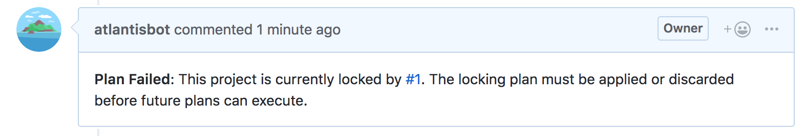
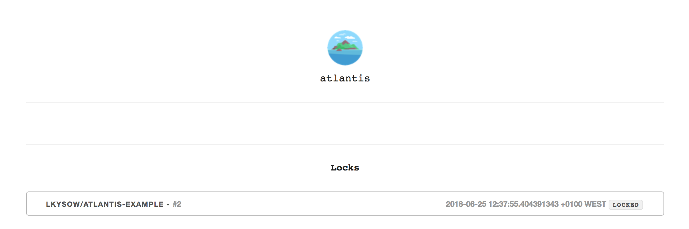
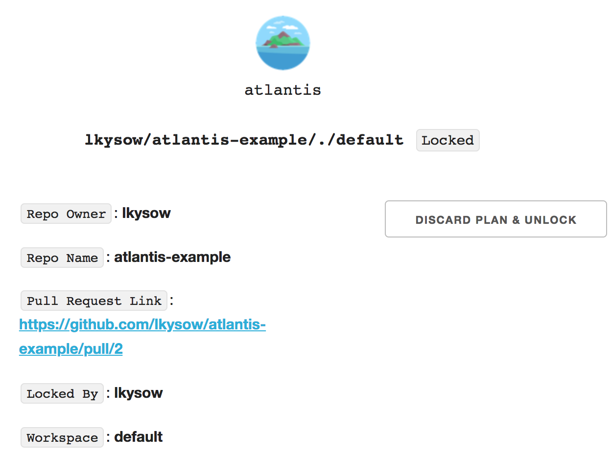
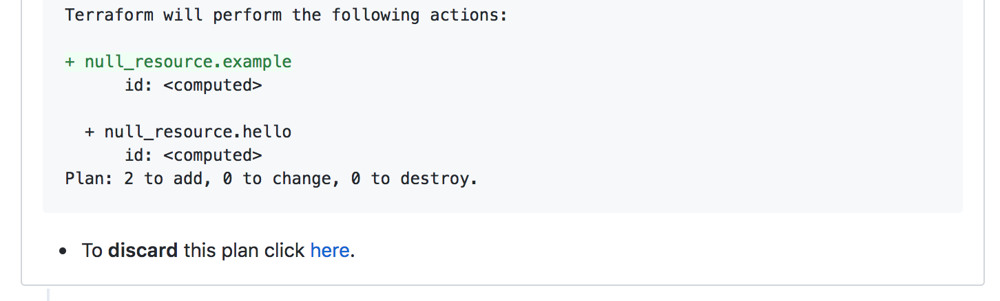

# Locking

When `plan` is run, the directory and Terraform workspace are **Locked** until the pull request is merged or closed, or the plan is manually deleted.

If another user attempts to `plan` for the same directory and workspace in a different pull request
they'll see this error:

Which links them to the pull request that holds the lock.

::: warning NOTE
Only the directory in the repo and Terraform workspace are locked, not the whole repo.
:::

Atlantis also checks the global apply lock before running `atlantis apply`. If Atlantis cannot reach the lock backend while checking that global lock, it fails closed and rejects the apply until the backend is reachable again.

Within one pull request, `atlantis plan` and an untargeted `atlantis apply` do not run alongside another plan or apply. Atlantis rejects the second command rather than queueing it, so comment it again once the first one finishes. Targeted applies (`-p`, `-d` or `-w`) can run at the same time when their projects are in different directories or workspaces, such as `atlantis apply -w staging` and `atlantis apply -w qa`. Projects that share a directory and workspace share it on disk, so an apply of one is rejected while another is being applied, and so is a second apply of the same project.

`atlantis cancel` releases these locks while running commands carry on, so after a cancel a second apply of a project that is still being applied can start.

Some steps also take the lock on a workspace's root directory (`.`), so they can reject or skip part of another command:

- Preparing a `-d` or `-w` apply takes the root lock briefly, and the apply is rejected if the lock is held. `-p` applies don't take it.
- Planning or applying an unnamed project at the repository root holds the root lock for that project's whole run.
- With [pre-workflow hooks](pre-workflow-hooks.md), each command holds the default workspace's root lock while its hooks run. A command that cannot take the lock skips its pre-workflow hooks, or fails if [`--fail-on-pre-workflow-hook-error`](server-configuration.md#fail-on-pre-workflow-hook-error) is set.
- With [post-workflow hooks](post-workflow-hooks.md), a command that cannot take the default workspace's root lock skips its post-workflow hooks.

So while an unnamed project at the repository root is planned or applied in the default workspace, other commands on the pull request skip their hooks.

## Why

1. Because `atlantis apply` is being done before the pull request is merged, after
an apply your `main` branch does not represent the most up-to-date version of your infrastructure
anymore. With locking, you can ensure that no other changes will be made until the
pull request is merged.

::: tip Why not apply on merge?
Sometimes `terraform apply` fails. If the apply were to fail after the pull
request was merged, you would need to create a new pull request to fix it.
With locking + applying on the branch, you effectively mimic merging to main
but with the added ability to re-plan/apply multiple times if things don't work.
:::
2. If there is already a `plan` in progress, other users won't see a plan that
will be made invalid after the in-progress plan is applied.

## Viewing Locks

To view locks, go to the URL that Atlantis is hosted at:

You can click on a lock to view its details:

    

## Unlocking

The project and workspace will be automatically unlocked when the PR is merged or closed.

To unlock the project and workspace without completing an `apply` and merging, comment `atlantis unlock` on the PR,
or click the link at the bottom of the plan comment to discard the plan and delete the lock where
it says **"To discard this plan click here"**:

The link will take you to the lock detail view where you can click **Discard Plan and Unlock**
to delete the lock.

    

Once a plan is discarded, you'll need to run `plan` again prior to running `apply` when you go back to that pull request.

## Relationship to Terraform State Locking

Atlantis does not conflict with [Terraform State Locking](https://developer.hashicorp.com/terraform/language/state/locking). Under the hood, all
Atlantis is doing is running `terraform plan` and `apply` and so all of the
locking built in to those commands by Terraform isn't affected.

In more detail, Terraform state locking locks the state while you run `terraform apply`
so that multiple applies can't run concurrently. Atlantis's locking is at a higher
level because it prevents multiple pull requests from working on the same state.

## Locking and Drift Detection

When drift detection or remediation runs via the [API](api-endpoints.md) with `PR: 0` (non-PR workflow), Atlantis still acquires and releases working directory locks to prevent concurrent operations on the same project. However, since these operations are not associated with a pull request, they do not create PR-level locks visible in the Locks UI. The working directory lock is released automatically after each drift detection or remediation operation completes.
