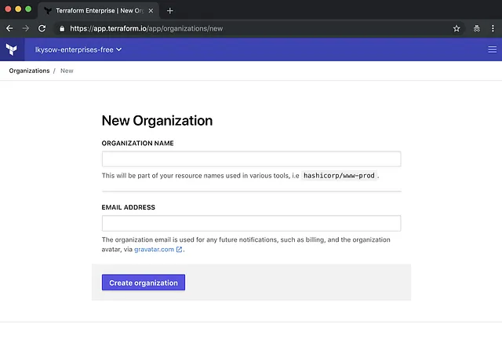
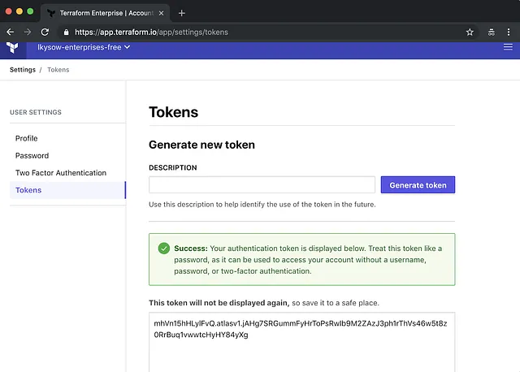
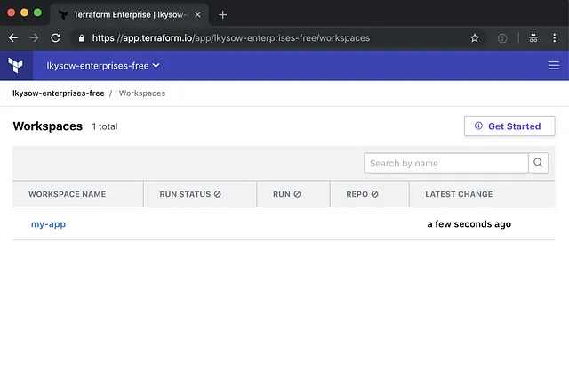
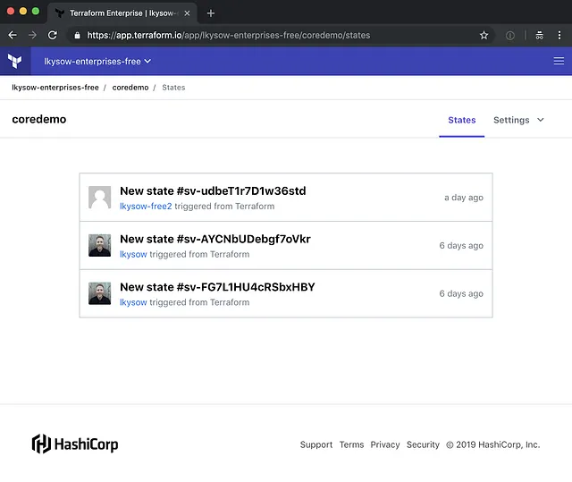
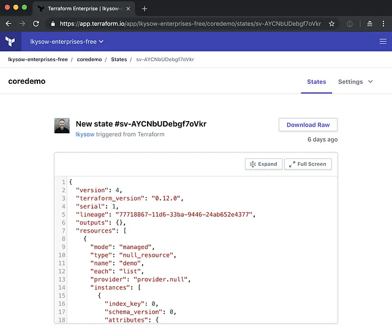
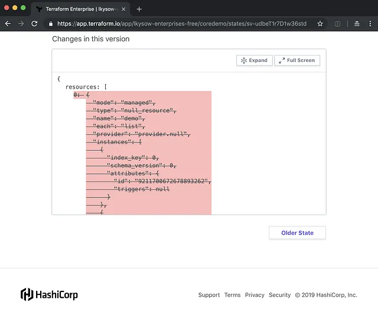
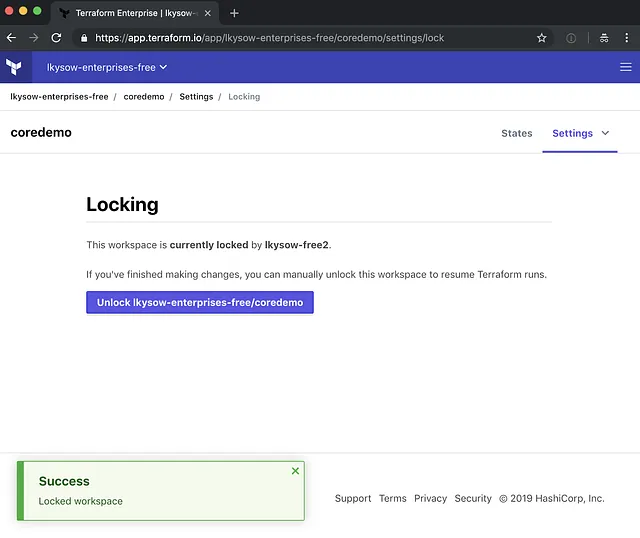
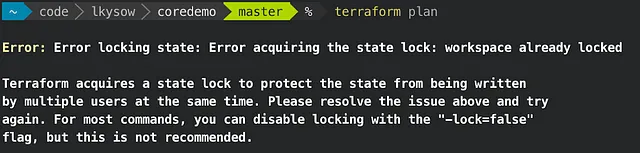

# 4 razones para probar el (nuevo) almacenamiento remoto de estado gratuito de Terraform de HashiCorp

::: info
Esta publicación fue escrita originalmente el 2 de abril de 2019

Publicación original: <https://medium.com/runatlantis/4-reasons-to-try-hashicorps-new-free-terraform-remote-state-storage-b03f01bfd251>
:::

Actualización (20 de mayo de 2019) — Free State Storage ahora se llama Terraform Cloud y salió de Beta, lo que significa que cualquiera puede registrarse.

HashiCorp está planeando ofrecer almacenamiento remoto de estado de Terraform gratuito y ahora tienen una versión beta disponible. En este artículo, hablo sobre 4 razones por las que deberías probarlo (Divulgación: trabajo en HashiCorp).

> _[Regístrate en Terraform Cloud](https://goo.gl/X5t5EM)._

## ¿Qué es el estado de Terraform?

Antes de entrar en por qué deberías usar el nuevo almacenamiento remoto de estado, hablemos sobre qué queremos decir exactamente con estado en Terraform.

Terraform usa _state_ para mapear tu código de Terraform a los recursos del mundo real que aprovisiona. Por ejemplo, si tengo código de Terraform para crear una instancia EC2 de AWS:

```tf
resource "aws_instance" "web" {
  ami           = "ami-e6d9d68c"
  instance_type = "t2.micro"
}
```

Cuando ejecuto `terraform apply`, Terraform hará una llamada API de “crear instancia EC2” a AWS y AWS devolverá el ID único de esa instancia (p. ej. `i-0ad17607e5ee026d0`). Terraform necesita registrar ese ID en algún lugar para que más tarde pueda hacer llamadas API para cambiar o eliminar la instancia.

Para almacenar esta información, Terraform usa un archivo de estado. Para el código anterior, el archivo de estado se verá más o menos así:

```json{4,7}
{
    ...
    "resources": {
      "aws_instance.web": {
        "type": "aws_instance",
        "primary": {
          "id": "i-0ad17607e5ee026d0",
     ...
}
```

Aquí puedes ver que el recurso `aws_instance.web` de nuestro código de Terraform está mapeado al ID de instancia `i-0ad17607e5ee026d0`.

Entonces, si el estado de Terraform es solo un archivo, ¿qué es el estado remoto?

## Estado remoto

Por defecto, Terraform escribe su archivo de estado en tu sistema de archivos local. Esto está bien para proyectos personales, pero una vez que empiezas a trabajar con un equipo, las cosas se complican. En un equipo, necesitas asegurarte de que todos tengan una versión actualizada del archivo de estado **y** garantizar que dos personas no estén haciendo cambios concurrentes.

¡Aquí entra el estado remoto! El estado remoto es simplemente almacenar el archivo de estado de forma remota, en lugar de hacerlo en tu sistema de archivos. Con estado remoto, solo hay una copia, por lo que Terraform puede garantizar que siempre estés actualizado. Para evitar que los miembros del equipo modifiquen el estado al mismo tiempo, Terraform puede bloquear el estado remoto.

> El estado remoto es simplemente almacenar el archivo de estado de forma remota, en lugar de hacerlo en tu sistema de archivos.

Bien, el estado remoto es excelente, pero desafortunadamente configurarlo puede ser un poco complicado. En AWS, puedes almacenarlo en un bucket de S3, pero necesitas crear el bucket, configurarlo correctamente, configurar correctamente sus permisos, crear una tabla de DynamoDB para el bloqueo y luego asegurarte de que todos tengan las credenciales adecuadas para escribir en él. Es prácticamente la misma historia en las otras nubes.

Como resultado, configurar el estado remoto puede ser un obstáculo molesto mientras los equipos adoptan Terraform.

Esto nos lleva a la primera razón para probar el Free Remote State Storage de HashiCorp...

## Razón n.º 1 — Fácil de configurar

A diferencia de otras soluciones de estado remoto que requieren una configuración complicada para hacerlo bien, configurar el almacenamiento remoto de estado gratuito es fácil.

> Configurar el almacenamiento remoto de estado gratuito de HashiCorp es fácil

Paso 1 — Regístrate para obtener tu cuenta [gratuita de Terraform Cloud](https://app.terraform.io/signup)

Paso 2 — Cuando inicies sesión, llegarás a esta página donde crearás tu organización:



Paso 3 — A continuación, ve a User Settings y genera un token:



Paso 4 — Toma este token y crea un archivo local ~/.terraformrc:

```tf
credentials "app.terraform.io" {
  token = "mhVn15hHLylFvQ.atlasv1.jAH..."
}
```

Paso 5 — ¡Eso es todo! Ahora estás listo para almacenar tu estado.

En tu proyecto de Terraform, agrega un bloque `terraform`:

```tf{3,5}
terraform {
  backend "remote" {
    organization = "my-org" # org name from step 2.
    workspaces {
      name = "my-app" # name for your app's state.
    }
  }
}
```

Ejecuta `terraform init` y ¡listo! Tu estado ahora está siendo almacenado en Terraform Enterprise. Puedes ver el estado en la UI:



Hablando de ver el estado en una UI...

## Razón n.º 2 — Visor de estado con todas las funciones

La segunda razón para probar Terraform Cloud es su visor de estado con todas las funciones:



Si alguna vez arruinaste tu estado de Terraform y necesitaste descargar una versión antigua o quisiste un registro de auditoría para saber quién cambió qué, entonces te encantará esta función.

Puedes ver el archivo de estado completo en cada punto en el tiempo:



También puedes ver el diff de lo que cambió:



Por supuesto, puedes encontrar una forma de obtener esta información de algunos de los otros backends de estado, pero es difícil. Con el almacenamiento remoto de estado de HashiCorp, la obtienes gratis.

## Razón n.º 3 — Bloqueo manual

La tercera razón para probar Terraform Cloud es la capacidad de bloquear manualmente tu estado.

¿Alguna vez has estado trabajando en una parte de la infraestructura y has querido asegurarte de que nadie pudiera hacer cambios en ella al mismo tiempo?

Terraform Cloud viene con la capacidad de bloquear y desbloquear estados desde la UI:



Mientras el estado está bloqueado, las operaciones `terraform` recibirán un error:



Esto te ahorra muchos de estos:


## Razón n.º 4 — Funciona con Atlantis

La razón final para probar Terraform Cloud es que funciona perfectamente con [Atlantis](https://www.runatlantis.io/)!

Establece una variable de entorno `ATLANTIS_TFE_TOKEN` en un token de TFE y estarás listo. Ve a <https://www.runatlantis.io/docs/terraform-cloud.html> para obtener más información.

Conclusión
Te animo encarecidamente a probar el nuevo backend gratuito de Remote State Storage. Es una oferta convincente frente a otros backends de estado gracias a su facilidad de configuración, su visor de estado con todas las funciones y sus capacidades de bloqueo.

Si no estás en la lista de espera, regístrate aquí: <https://app.terraform.io/signup>.
