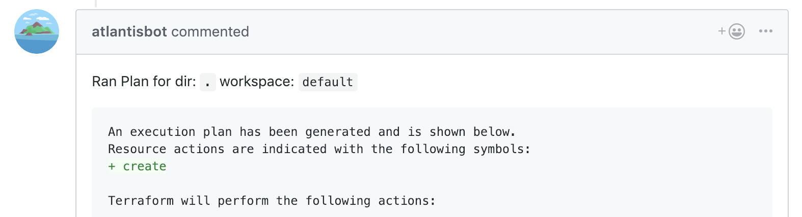
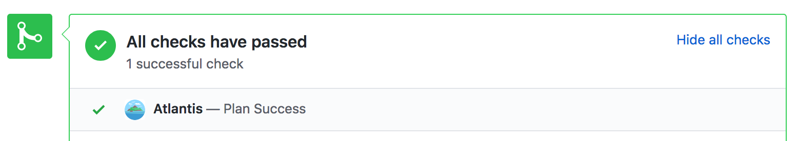

# Credenciales de acceso del host Git

Esta página describe cómo crear credenciales para su host Git (GitHub, GitLab, Gitea, Bitbucket o Azure DevOps)

que Atlantis usará para hacer llamadas a la API.

## Crear un usuario de Atlantis (opcional)

Recomendamos crear un nuevo usuario llamado **@atlantis** (o algo parecido) o usar un usuario de CI dedicado.

Esto no es obligatorio (puede usar un usuario existente o credenciales de GitHub app), sin embargo todos los comentarios que Atlantis escribe
vendrán de ese usuario, por lo que podría ser confuso si vienen de una cuenta personal.

<i>Un comentario de ejemplo que viene del usuario @atlantisbot</i>

## Generar un token de acceso

Una vez que haya creado un nuevo usuario (o decidido usar uno existente), necesita
generar un token de acceso. Continúe leyendo las instrucciones para su host Git específico:

* [GitHub](#github-user)
* [GitHub app](#github-app)
* [GitLab](#gitlab)
* [Gitea](#gitea)
* [Bitbucket Cloud (bitbucket.org)](#bitbucket-cloud-bitbucket-org)
* [Bitbucket Server (aka Stash)](#bitbucket-server-aka-stash)
* [Azure DevOps](#azure-devops)

### GitHub user

* Cree un [Personal Access Token](https://docs.github.com/en/authentication/keeping-your-account-and-data-secure/creating-a-personal-access-token#creating-a-fine-grained-personal-access-token)
* Cree el token con alcance **repo**
  * Los siguientes permisos de repositorio son el mínimo requerido:
    * Commit statuses: lectura y escritura (para actualizar el PR con indicadores de los estados de los trabajos de plan/apply/policy)
    * Contents: solo lectura (para obtener los archivos modificados y clonar el repositorio)
    * Metadata: solo lectura (esto se seleccionará automáticamente como obligatorio cuando Contents esté configurado como solo lectura)
    * Pull requests: lectura y escritura (para comentar y reaccionar en el PR)
* Registre el token de acceso
::: warning
Su usuario de Atlantis también debe tener "Write permissions" (para repos en una organización) o ser un "Collaborator" (para repos en una cuenta de usuario) para poder establecer commit statuses:

:::

### GitHub app

#### Crear la GitHub App usando Atlantis

::: warning
Disponible en versiones de Atlantis **posteriores** a 0.13.0.
:::

::: warning
Mientras no haya una GitHub App configurada, las páginas `/github-app/setup` e `/github-app/exchange-code` son accesibles por cualquiera que pueda alcanzar Atlantis, y la página de intercambio muestra la nueva clave privada y el secreto del webhook de la app. Protéjalas durante la instalación pasando también `--web-basic-auth --web-username <user> --web-password <password>`, y ejecute la configuración solo desde una red confiable. Atlantis vincula la redirección de GitHub con la página de configuración mediante un nonce de un solo uso `state` y una cookie `HttpOnly` establecida en el navegador que abrió la página de configuración. Ambos expiran después de 10 minutos, así que complete el flujo de una vez desde el mismo navegador, con las cookies habilitadas, y vuelva a cargar la página de configuración si expira o si el intercambio falla.
:::

::: warning Cambio de comportamiento
Anteriormente, `/github-app/exchange-code` aceptaba cualquier `code` sin verificar dónde comenzó el flujo, y ambas páginas seguían funcionando después de que una app hubiera sido creada hasta que Atlantis se reiniciaba con credenciales de GitHub. Ahora la redirección debe llevar el nonce `state` emitido por `/github-app/setup` y llegar en el mismo navegador dentro de 10 minutos, y ambas páginas devuelven HTTP 400 `Atlantis already has GitHub credentials` tan pronto como un intercambio se realiza con éxito, así que registre las credenciales mostradas antes de salir de la página. Una redirección desde otro navegador, con cookies bloqueadas, o después de 10 minutos devuelve HTTP 400 `GitHub app setup state is not valid for this browser, start again from /github-app/setup` o `GitHub app setup state expired, start again from /github-app/setup`; abra `/github-app/setup` de nuevo en un navegador y termine sin demora.
:::

* Inicie Atlantis con un nombre de usuario y token falsos de GitHub (`atlantis server --gh-user fake --gh-token fake --repo-allowlist 'github.com/your-org/*' --atlantis-url https://$ATLANTIS_HOST`). Si está instalando como una **Organization**, recuerde agregar `--gh-org your-github-org` a este comando.
* Visite `https://$ATLANTIS_HOST/github-app/setup` y haga clic en **Setup** para crear la app en GitHub. Será redirigido de vuelta a Atlantis
* Un enlace para instalar su app, junto con sus secretos, se mostrará en la pantalla. Registre las credenciales de su app e instale su app para su usuario/org siguiendo dicho enlace.
* Cree un archivo con el contenido de la GitHub App Key, por ejemplo `atlantis-app-key.pem`
* Reinicie Atlantis con nuevas flags: `atlantis server --gh-app-id <your id> --gh-app-key-file atlantis-app-key.pem --gh-webhook-secret <your secret> --write-git-creds --repo-allowlist 'github.com/your-org/*' --atlantis-url https://$ATLANTIS_HOST`.

  NOTE: En lugar de usar un archivo para la GitHub App Key, también puede pasar el valor de la clave directamente usando `--gh-app-key`. También puede crear un archivo de configuración en lugar de usar flags. Consulte [Server Configuration](server-configuration.md#config-file).

::: warning
En este momento, solo se admite una única instalación por GitHub App.
:::

::: tip NOTE
GitHub App maneja las llamadas de webhook por sí misma, por lo tanto no hay necesidad de crear webhooks por separado. Si los webhooks fueron creados manualmente, pueden eliminarse al usar GitHub App. De lo contrario, habría 2 llamadas a Atlantis que darían como resultado errores de bloqueo en path/workspace.

Los webhooks pueden crearse manualmente o ser gestionados por la GitHub App para los repositorios que activan Atlantis. Si los crea manualmente (vea la [sección a continuación](access-credentials.md#manually-creating-the-github-app)), no especifique detalles del webhook en la configuración de la GitHub app. En ambos casos se recomienda encarecidamente proteger los webhooks usando un secreto. Consulte [Webhook Secrets](webhook-secrets.md#webhook-secrets)
:::

#### Creación manual de la GitHub app

* Cree la GitHub app como un Administrator
  * Asegúrese de que la app esté registrada / instalada con la organización / usuario
  * Consulte la [documentación](https://docs.github.com/en/apps/creating-github-apps/about-creating-github-apps/about-creating-github-apps) de GitHub app
* Cree un archivo con el contenido de la GitHub App Key, por ejemplo `atlantis-app-key.pem`
* Inicie Atlantis con las siguientes flags: `atlantis server --gh-app-id <your id> --gh-installation-id <installation id> --gh-app-key-file atlantis-app-key.pem --gh-webhook-secret <your secret> --write-git-creds --repo-allowlist 'github.com/your-org/*' --atlantis-url https://$ATLANTIS_HOST`.

  NOTE: En lugar de usar un archivo para la GitHub App Key, también puede pasar el valor de la clave directamente usando `--gh-app-key`. También puede crear un archivo de configuración en lugar de usar flags. Consulte [Server Configuration](server-configuration.md#config-file).

::: tip NOTE
Instalar manualmente la GitHub app significa que las credenciales pueden ser compartidas por muchas instalaciones de Atlantis. Esto tiene el beneficio de centralizar el acceso al repositorio para módulos / código compartidos.
:::

::: tip NOTE
Los repositorios deben registrarse manualmente con la GitHub app creada para permitir que Atlantis interactúe con Pull Requests.
:::

::: tip NOTE
Pasar la flag adicional `--gh-app-slug` modificará el nombre de la App al publicar comentarios en un Pull Request.
:::

#### Permisos

GitHub App necesita estos permisos. Estos se establecen automáticamente cuando se crea una GitHub app.

::: tip NOTE
Desde v0.19.7, se ha agregado un nuevo permiso para `Administration`. Si ya ha creado una GitHub app, actualizar Atlantis a v0.19.7 no agregará automáticamente este permiso, por lo que necesitará configurarlo manualmente.

Desde v0.22.3, se ha agregado un nuevo permiso para `Members`, que es necesario para las funciones que aplican permisos a los miembros del equipo de una organización en lugar de a usuarios individuales. Al igual que el permiso `Administration` anterior, actualizar Atlantis no agregará automáticamente este permiso, por lo que si desea usar funciones que dependen de comprobar la membresía del equipo, necesitará agregarlo manualmente.

Desde v0.30.0, se ha agregado un nuevo permiso para `Actions`, que es necesario para comprobar si un pull request se puede fusionar mientras se omite la comprobación de apply. Actualizar Atlantis no agregará automáticamente este permiso, por lo que necesitará agregarlo manualmente.
:::

| Type            | Access              |
| --------------- | ------------------- |
| Administration  | Read-only           |
| Checks          | Read and write      |
| Commit statuses | Read and write      |
| Contents        | Read and write      |
| Issues          | Read and write      |
| Metadata        | Read-only (default) |
| Pull requests   | Read and write      |
| Webhooks        | Read and write      |
| Members         | Read-only           |
| Actions         | Read-only           |

### GitLab

* Siga: [GitLab: Create a personal access token](https://docs.gitlab.com/user/profile/personal_access_tokens/#create-a-personal-access-token)
* Cree un token con alcance **api**
* Registre el token de acceso

### Gitea

* Vaya a "Profile and Settings" > "Settings" en Gitea (arriba a la derecha)
* Vaya a "Applications" en "User Settings" en Gitea
* Cree un token en "Manage Access Tokens" con los siguientes permisos:
  * issue: Read and Write
  * repository: Read and Write
  * user: Read
* Registre el token de acceso

### Bitbucket Cloud (bitbucket.org)

* Cree una App Password siguiendo [BitBucket Cloud: Create an app password](https://support.atlassian.com/bitbucket-cloud/docs/create-an-app-password/)
* Etiquete la contraseña como "atlantis"
* Seleccione **Pull requests**: **Read** y **Write** para que Atlantis pueda leer sus pull requests y escribir comentarios en ellos. Si desea habilitar la función [hide-prev-plan-comments](server-configuration.md#hide-prev-plan-comments) y por lo tanto eliminar comentarios antiguos, agregue también **Account**: **Read**.
* Registre el token de acceso

### Bitbucket Server (aka Stash)

* Haga clic en su avatar en la parte superior derecha y seleccione **Manage account**
* Haga clic en **Personal access tokens** en la barra lateral
* Haga clic en **Create a token**
* Asigne al token el nombre **atlantis**
* Otorgue al token permisos de proyecto **Read** y permisos de Pull request **Write**
* Haga clic en **Create** y registre el token de acceso

  NOTE: Atlantis enviará el token como [Bearer Auth a la Bitbucket API](https://confluence.atlassian.com/bitbucketserver/http-access-tokens-939515499.html#HTTPaccesstokens-UsingHTTPaccesstokens) en lugar de usar Basic Auth.

### Azure DevOps

* Cree un Personal access token siguiendo [Azure DevOps: Use personal access tokens to authenticate](https://docs.microsoft.com/en-us/azure/devops/organizations/accounts/use-personal-access-tokens-to-authenticate?view=azure-devops)
* Etiquete la contraseña como "atlantis"
* Los alcances mínimos requeridos para este token son:
  * Code (Read & Write)
  * Code (Status)
  * Member Entitlement Management (Read)
* Registre el token de acceso

## Próximos pasos

Una vez que tenga su usuario y token de acceso, estará listo para crear un secreto de webhook. Consulte [Creating a Webhook Secret](webhook-secrets.md).
