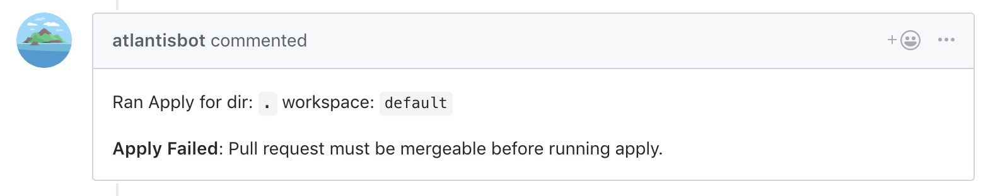

# Requisitos de comandos

## Introducción

Atlantis requiere que se cumplan ciertas condiciones **before** `atlantis apply`, `atlantis import`
y los comandos `atlantis state rm` puedan ejecutarse:

* [Approved](#approved) – requiere que los pull requests sean aprobados por al menos un usuario distinto del autor
* [Mergeable](#mergeable) – requiere que los pull requests puedan ser fusionados
* [UnDiverged](#undiverged) - requiere que los archivos del proyecto en los pull requests estén por delante de la rama base

`atlantis state rm` reescribe el estado de Terraform sin un plan revisado, por lo que debe satisfacer
**both** la `apply_requirements` del proyecto y su `import_requirements`. No hay una
clave `state_rm_requirements` separada.

::: warning Cambio de comportamiento
Anteriormente, `atlantis state rm` ignoraba todos los requisitos de comando y se ejecutaba para
cualquier usuario autorizado a comentar. Ahora debe cumplir cada requisito listado en la
`apply_requirements` y `import_requirements` del proyecto, incluyendo
`policies_passed` si está establecido. Si cualquiera de las dos listas está establecida, espere que `state rm` sea rechazado
en pull requests que no lo cumplan, con mensajes como
`Pull request must be approved according to the project's approval rules before running state.`
o `Pull request must be mergeable before running state.` Obtenga que el pull request
sea aprobado o mergeable primero, o ajuste esas listas si `state rm` debería permitirse antes.
:::

## ¿Qué sucede si no se cumple el requisito?

Si no se cumple el requisito, los usuarios verán un error si intentan ejecutar `atlantis apply`:



## Requisitos soportados

### Approved

El requisito `approved` impedirá los applys a menos que el pull request sea aprobado
por al menos una persona distinta del autor.

#### Uso

Establezca el requisito `approved` mediante:

1. Crear un archivo `repos.yaml` con la clave `apply_requirements`:

   ```yaml
   repos:
   - id: /.*/
     apply_requirements: [approved]
   ```

1. O permitiendo que un archivo `atlantis.yaml` especifique la clave `apply_requirements` en la configuración de `repos.yaml`:

    **repos.yaml**

    ```yaml
    repos:
    - id: /.*/
      allowed_overrides: [apply_requirements]
    ```

    **atlantis.yaml**

    ```yaml
    version: 3
    projects:
    - dir: .
      apply_requirements: [approved]
    ```

#### Significado

Cada proveedor de VCS tiene reglas diferentes sobre quién puede aprobar:

* **GitHub** – **Cualquier usuario con permisos de lectura** en el repositorio puede aprobar un pull request
* **GitLab** – El usuario que puede aprobar puede establecerse en la [configuración del repositorio](https://docs.gitlab.com/user/project/merge_requests/approvals/)
* **Bitbucket Cloud (bitbucket.org)** – Un usuario puede aprobar su propio pull request pero
  Atlantis no cuenta eso como una aprobación y requiere una aprobación de al menos un usuario que
  no sea el autor del pull request
* **Azure DevOps** – **Todos los grupos integrados incluyen el permiso "Contribute to pull requests"** y pueden aprobar un pull request

En GitHub y Gitea, Atlantis lee cada review del pull request y usa la review más reciente de cada
reviewer que sea approving o changes-requested. El requisito se cumple cuando al
menos la review más reciente de ese tipo de un reviewer es una aprobación actual. Las reviews solo con comentarios se
ignoran. Los cambios solicitados por un reviewer diferente no cancelan la aprobación de otra persona;
use el requisito [mergeable](#mergeable) con branch protection si necesita eso.

* **GitHub** – una aprobación deja de contar si el mismo reviewer después solicita cambios, o
  si es descartada.
* **Gitea** – una aprobación deja de contar si el mismo reviewer después solicita cambios, si
  es descartada, o si Gitea la marca como stale. Gitea marca una review como stale cuando un push al
  pull request cambia su diff contra la base después de que la review fue enviada. Esto
  sucede independientemente de si la configuración de branch protection "Dismiss stale approvals" está habilitada o no.
  Los reviewers deben aprobar de nuevo después de ese push.

::: warning Cambio de comportamiento
Anteriormente, en GitHub, cualquier review `APPROVED` satisfacía `approved`, incluso si el mismo reviewer después solicitaba cambios. Ahora solo cuenta la review más reciente de aprobar o solicitar cambios de cada reviewer, por lo que un "Request changes" posterior o un descarte por parte de ese reviewer cancela su aprobación. Si Atlantis responde `Pull request must be approved according to the project's approval rules before running apply.` en un pull request que muestra una aprobación, verifique si hay un "Request changes" posterior o un descarte por parte de ese aprobador.
:::

::: warning Cambio de comportamiento
Anteriormente, en Gitea, cualquier review con estado `APPROVED` satisfacía `approved`, incluidas aprobaciones descartadas y aprobaciones dadas antes de que pushes posteriores cambiaran el diff. Ahora las aprobaciones descartadas y stale no cuentan, y un "Request changes" posterior por el mismo reviewer cancela su aprobación. Después de un push que cambia el diff del pull request, un reviewer debe aprobar de nuevo; hasta entonces Atlantis responde `Pull request must be approved according to the project's approval rules before running apply.`
:::

:::tip Consejo
Para requerir que **ciertas personas** aprueben el pull request, vea el
requisito [mergeable](#mergeable).
:::

### Mergeable

El requisito `mergeable` impedirá los applys a menos que un pull request pueda ser fusionado.

#### Uso

Establezca el requisito `mergeable` mediante:

1. Crear un archivo `repos.yaml` con la clave `apply_requirements`:

   ```yaml
   repos:
   - id: /.*/
     apply_requirements: [mergeable]
   ```

1. O permitiendo que un archivo `atlantis.yaml` especifique las claves `plan_requirements`, `apply_requirements` e `import_requirements` en la configuración de `repos.yaml`:

    **repos.yaml**

    ```yaml
    repos:
    - id: /.*/
      allowed_overrides: [plan_requirements, apply_requirements, import_requirements]
    ```

    **atlantis.yaml**

    ```yaml
    version: 3
    projects:
    - dir: .
      plan_requirements: [mergeable]
      apply_requirements: [mergeable]
      import_requirements: [mergeable]
    ```

#### Significado

Cada proveedor de VCS tiene un concepto diferente de "mergeability":

::: warning
Algunos proveedores de VCS tienen una función de branch protection para controlar la "mergeability". Para usarla,
limite la rama base para no omitir la branch protection.
Vea también la palabra clave `branch` en [Server Side Repo Config](server-side-repo-config.md#reference) para más detalles.
:::

#### GitHub

En GitHub, si no está usando [Protected Branches](https://docs.github.com/en/repositories/configuring-branches-and-merges-in-your-repository/defining-the-mergeability-of-pull-requests/about-protected-branches), entonces
todos los pull requests son mergeable a menos que haya un conflicto.

Si configura Protected Branches, entonces puede imponer:

* Requerir que ciertas verificaciones de estado estén pasando
* Requerir que ciertas personas hayan revisado y aprobado el pull request
* Requerir que `CODEOWNERS` haya revisado y aprobado el pull request
* Requerir que la rama esté actualizada con `main`

Vea [GitHub: About protected branches](https://docs.github.com/en/repositories/configuring-branches-and-merges-in-your-repository/defining-the-mergeability-of-pull-requests/about-protected-branches)
para más detalles.

::: warning
Si tiene el requisito **Restrict who can push to this branch**, entonces
el usuario de Atlantis necesita ser parte de esa lista para que pueda considerar
un pull request como mergeable.
:::

::: warning
Si establece `atlantis/apply` en el requisito mergeable, use la flag `--gh-allow-mergeable-bypass-apply` o establezca la variable de entorno `ATLANTIS_GH_ALLOW_MERGEABLE_BYPASS_APPLY=true`. Esta flag y variable de entorno permiten que la verificación mergeable antes de ejecutar `atlantis apply` omita verificar el estado de `atlantis/apply`.
:::

#### GitLab

Para GitLab, una merge request será fusionada si todo lo siguiente es verdadero:

* No hay conflictos
* No hay discusiones sin resolver, si es un requisito del proyecto
* Todos los aprobadores necesarios han aprobado el pull request
* No está detrás de la rama en la que se fusiona, si los [Merge Methods](https://docs.gitlab.com/user/project/merge_requests/methods/) del proyecto son "Fast-forward merge" o "Merge commit with semi-linear history"

Para pipelines, si el proyecto requiere que los pipelines deban tener éxito, se verificarán todas las builds excepto el estado del comando apply.

Para Jobs con la configuración allow_failure establecida en true, se ignorarán. Si el pipeline ha sido omitido y el proyecto permite fusionar, será marcado como mergeable.

Para comandos `atlantis apply` por proyecto, Atlantis limita el requisito `mergeable` de GitLab al proyecto que se está aplicando cuando GitLab informa estados de commit bloqueantes. Atlantis ignora los estados de plan bloqueantes de Atlantis de otros proyectos en la misma merge request, pero el propio estado de plan del proyecto y cualquier bloqueador que no sea Atlantis siguen impidiendo el apply.

#### Bitbucket.org (Bitbucket Cloud) and Bitbucket Server (Stash)

Para Bitbucket, solo verificamos si hay un conflicto que impide una
fusión. No verificamos nada más porque la API de Bitbucket no lo soporta.

Si necesita una verificación específica, por favor
[open an issue](https://github.com/runatlantis/atlantis/issues/new).

#### Azure DevOps

En Azure DevOps, todos los pull requests son mergeable a menos que haya un conflicto. Puede establecer un pull request en "Complete" de inmediato, o establecer "Auto-Complete", que fusionará después de que se cumplan todas las políticas de rama. Vea [Review code with pull requests](https://docs.microsoft.com/en-us/azure/devops/repos/git/pull-requests?view=azure-devops).

Las [Branch policies](https://docs.microsoft.com/en-us/azure/devops/repos/git/branch-policies?view=azure-devops) pueden:

* Requerir un número mínimo de reviewers
* Permitir que los usuarios aprueben sus propios cambios
* Permitir completar incluso si algunos reviewers votan "Waiting" o "Reject"
* Restablecer los votos de los revisores de código cuando hay cambios nuevos
* Requerir una estrategia de fusión específica (squash, rebase, etc.)

::: warning
En este momento, el cliente de Azure DevOps solo soporta fusionar usando la estrategia predeterminada 'no fast-forward'. Asegúrese de que sus políticas de rama permitan este tipo de fusión.
:::

### UnDiverged

Impide los applys si hay cualquier cambio en la rama base desde el plan más reciente.
Se aplica solo a la estrategia de checkout `merge`, que necesita establecer mediante la flag `--checkout-strategy`.

#### Uso

Puede establecer el requisito `undiverged` mediante:

1. Crear un archivo `repos.yaml` con las claves `plan_requirements`, `apply_requirements` e `import_requirements`:

   ```yaml
   repos:
   - id: /.*/
     plan_requirements: [undiverged]
     apply_requirements: [undiverged]
     import_requirements: [undiverged]
   ```

1. O permitiendo que un archivo `atlantis.yaml` especifique las claves `plan_requirements`, `apply_requirements` y `import_requirements` en su configuración de `repos.yaml`:

    **repos.yaml**

    ```yaml
    repos:
    - id: /.*/
      allowed_overrides: [plan_requirements, apply_requirements, import_requirements]
    ```

    **atlantis.yaml**

    ```yaml
    version: 3
    projects:
    - dir: .
      plan_requirements: [undiverged]
      apply_requirements: [undiverged]
      import_requirements: [undiverged]
    ```

#### Significado

La estrategia de checkout `merge` crea un commit de fusión temporal y ejecuta `plan` sobre la versión local en Atlantis de la rama
origen y la rama destino del PR. La rama destino local puede quedar desactualizada ya que los cambios a la rama destino no se obtienen
si no hay cambios en la rama origen. `undiverged` exige que la versión local de main en Atlantis esté actualizada
con el remoto para que el estado del origen durante `apply` sea idéntico al que tendría si fusionara el PR en ese
momento. En el caso de un error transitorio, Atlantis asume divergencia por seguridad y devuelve un error.

Cuando un proyecto tiene configurados patrones `autoplan.when_modified`, el requisito `undiverged` usa automáticamente esos
patrones para realizar una verificación de divergencia **dirigida**. En lugar de fallar cuando **cualquier** archivo en la rama base ha cambiado,
solo falla cuando han cambiado archivos que coinciden con los patrones `when_modified` del proyecto. Esto es especialmente útil en
monorepos donde cambios no relacionados en otros proyectos no deberían bloquear sus applys.

Las verificaciones `undiverged` dirigidas también siguen la selección de proyectos de Atlantis para:

* proyectos configurados en el repositorio afectados a través de [module autoplanning](server-configuration.md#autoplan-modules)
* proyectos descubiertos automáticamente seleccionados por las reglas predeterminadas de `autoplan-file-list`

Si Atlantis no puede determinar el impacto del proyecto para un repositorio, `undiverged` vuelve a verificar todos los archivos.

**Ejemplo de escenario:**

```text
monorepo/
  project1/        # Has when_modified: ["project1/**"]
  project2/        # Has when_modified: ["project2/**"]
```

* El PR modifica `project1/main.tf`
* Después de que se crea el PR, alguien fusiona cambios en `project2/main.tf`
* El requisito `undiverged` para project1 **pasa** porque el cambio en la rama base solo afectó a `project2/`

## Establecer requisitos de comando

Como se mencionó arriba, puede establecer requisitos de comando mediante flags, en `repos.yaml`, o en `atlantis.yaml` si `repos.yaml`
permite la sobrescritura.

### Sobrescritura de flags

Las flags **sobrescriben** cualquier configuración de `repos.yaml` o `atlantis.yaml`, por lo que equivalen a
tener siempre establecido ese requisito de apply.

### Configuración específica por proyecto

Si solo quiere que algunos proyectos/repositorios tengan requisitos de apply, entonces debe

1. Especificar qué repositorios tienen qué requisitos mediante el archivo `repos.yaml`.

   ```yaml
   repos:
   - id: /.*/
     plan_requirements: [approved]
     apply_requirements: [approved]
     import_requirements: [approved]
   # Regex that defaults all repos to requiring approval
   - id: /github.com/runatlantis/.*/
     # Regex to match any repo under the atlantis namespace, and not require approval
     # except for repos that might match later in the chain
     plan_requirements: []
     apply_requirements: []
     import_requirements: []
   - id: github.com/runatlantis/atlantis
     plan_requirements: [approved]
     apply_requirements: [approved]
     import_requirements: [approved]
     # Exact string match of the github.com/runatlantis/atlantis repo
     # that sets apply_requirements to approved
   ```

1. Especificar qué proyectos tienen qué requisitos mediante un archivo `atlantis.yaml`, y permitir que
   `plan_requirements`, `apply_requirements` y `import_requirements` se establezcan en `atlantis.yaml` por la configuración de `repos.yaml`
   del lado del servidor.

   Por ejemplo, si tengo dos directorios, `staging` e `production`, podría usar:

   **repos.yaml:**

   ```yaml
   repos:
   - id: /.*/
     allowed_overrides: [plan_requirements, apply_requirements, import_requirements]
     # Allow any repo to specify apply_requirements in atlantis.yaml
   ```

   **atlantis.yaml:**

   ```yaml
   version: 3
   projects:
   - dir: staging
     # By default, plan_requirements, apply_requirements and import_requirements are empty so this
     # isn't strictly necessary.
     plan_requirements: []
     apply_requirements: []
     import_requirements: []
   - dir: production
     # This requirement will only apply to the
     # production directory.
     plan_requirements: [mergeable]
     apply_requirements: [mergeable]
     import_requirements: [mergeable]
   ```

### Múltiples requisitos

Puede establecer cualquiera o todos los requisitos `approved`, `mergeable` y `undiverged`.

## ¿Quién puede hacer apply?

Una vez que se satisface el requisito de apply, **cualquiera** que pueda comentar en el pull
request puede ejecutar el comando real `atlantis apply`.

## Siguientes pasos

* Para más información sobre reviews y aprobaciones de pull requests en GitHub, vea: [GitHub: About pull request reviews](https://docs.github.com/en/pull-requests/collaborating-with-pull-requests/reviewing-changes-in-pull-requests/about-pull-request-reviews)
* Para más información sobre reviews y aprobaciones de merge requests en GitLab (solo soportado en GitLab Enterprise), vea: [GitLab: Merge request approvals](https://docs.gitlab.com/user/project/merge_requests/approvals/).
* Para más información sobre reviews y aprobaciones de pull requests en Bitbucket, vea: [BitBucket: Use pull requests for code review](https://confluence.atlassian.com/bitbucket/pull-requests-and-code-review-223220593.html)
* Para más información sobre reviews y aprobaciones de pull requests en Azure DevOps, vea: [Azure DevOps: Create pull requests](https://docs.microsoft.com/en-us/azure/devops/repos/git/pull-requests?view=azure-devops&tabs=browser)
