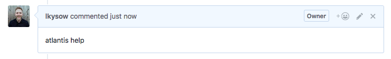

# Uso de Atlantis

Atlantis activa comandos mediante comentarios de pull request.



::: tip
Puede usar los siguientes nombres ejecutables.

* `atlantis help`
  * `atlantis` es un nombre ejecutable. Puede configurarlo mediante [Executable Name](server-configuration.md#executable-name).
* `run help`
  * `run` es un nombre ejecutable global.
* `@GithubUser help`
  * `@GithubUser` es el usuario del host VCS que conectó a Atlantis mediante token de usuario.
:::

Actualmente, Atlantis admite los siguientes comandos.

---

## atlantis help

```bash
atlantis help
```

### Explicación

Ver ayuda

---

## atlantis version

```bash
atlantis version
```

### Explicación

Imprime la salida de 'terraform version'.

---

## atlantis plan

```bash
atlantis plan [options] -- [terraform plan flags]
```

### Explicación

Ejecuta `terraform plan` en la rama del pull request. Puede que desee volver a ejecutar plan después de que Atlantis ya lo haya hecho
si ha cambiado manualmente algunos recursos.

### Ejemplos

```bash
# Runs plan for any projects that Atlantis thinks were modified.
# If an `atlantis.yaml` file is specified, runs plan on the projects that
# were modified as determined by the `when_modified` config.
atlantis plan

# Runs plan in the root directory of the repo with workspace `default`.
atlantis plan -d .

# Runs plan in the `project1` directory of the repo with workspace `default`
atlantis plan -p project1

# Runs plan in the root directory of the repo with workspace `staging`
atlantis plan -w staging
```

### Opciones

* `-d directory` En qué directorio ejecutar plan relativo a la raíz del repo. Use `.` para la raíz.
  * Ej. `atlantis plan -d child/dir`
* `-p project` Para qué proyecto ejecutar plan. Se refiere al nombre del proyecto configurado en el archivo [`atlantis.yaml` del repo](repo-level-atlantis-yaml.md). No puede usarse al mismo tiempo que `-d` o `-w` porque el proyecto ya define esto.
* `-w workspace` Cambia a este [Terraform workspace](https://developer.hashicorp.com/terraform/language/state/workspaces) antes de planificar. El valor predeterminado es `default`. Ignore esto si no usa Terraform workspaces. Los nombres de workspace no pueden contener `/`, `\\`, `..`, `$`, espacios en blanco o caracteres de control, y no pueden comenzar con `-` o `~`.
* `--verbose` Agrega el log de Atlantis al comentario.

::: warning NOTE
Un `atlantis plan` (sin flags), como los autoplans, descarta todos los plans creados previamente con `atlantis plan` `-p`/`-d`/`-w`
:::

### Flags adicionales de Terraform

Si `terraform plan` requiere argumentos adicionales, como `-target=resource` o `-var 'foo=bar'` o `-var-file myfile.tfvars`
puede agregarlos al final del comentario después de `--`, ej.

```shell
atlantis plan -d dir -- -var foo='bar'
```

Las flags que cambian dónde Terraform se ejecuta o escribe archivos no están permitidas después de `--`: `-chdir`, `-plugin-dir`, `-out`, `-generate-config-out`, `-state`, `-state-out` y `-backup`, en cualquier escritura, además de cualquier flags listada en [--blocked-extra-args](server-configuration.md#blocked-extra-args). Las rutas de `-var-file` deben estar dentro del repositorio o en un directorio listado en [--var-file-allowlist](server-configuration.md#var-file-allowlist). Las mismas reglas se aplican a `apply`, `import` y `state rm`.

::: warning Cambio de comportamiento
Anteriormente, `atlantis plan -- -generate-config-out=FILE` podía usarse para generar configuración para bloques `import`. Ahora `-generate-config-out` está bloqueado en comentarios y falla con `flag "-generate-config-out=FILE" is not allowed in extra args`. Pide a tu operador de Atlantis un workflow del lado del servidor cuyo paso `plan` establezca `-generate-config-out` en `extra_args`.
:::

Si siempre necesitas añadir una determinada flag, consulta [Custom Workflow Use Cases](custom-workflows.md#adding-extra-arguments-to-terraform-commands).

### Archivos automáticos de variables de entorno

Atlantis incluye automáticamente archivos de variables específicos del workspace si existen en tu repositorio. Esta funcionalidad ayuda a reducir la duplicación entre distintos entornos y workspaces.

#### Cómo funciona

Al ejecutar `atlantis plan`, Atlantis comprueba automáticamente si existe un archivo en `env/{workspace}.tfvars` relativo al directorio del proyecto. Si este archivo existe, Atlantis lo incluirá automáticamente usando la flag `-var-file`.

#### Ejemplos

```plain
my-terraform-project/
├── main.tf
├── variables.tf
└── env/
    ├── default.tfvars
    ├── staging.tfvars
    └── production.tfvars
```

Cuando ejecutas:

* `atlantis plan` (usa el workspace predeterminado) incluye automáticamente `env/default.tfvars`
* `atlantis plan -w staging` incluye automáticamente `env/staging.tfvars`
* `atlantis plan -w production` incluye automáticamente `env/production.tfvars`

::: tip
Esta funcionalidad funciona para cualquier nombre de workspace. Si tienes un workspace personalizado llamado `dev-team-1`, Atlantis buscará `env/dev-team-1.tfvars`.
:::

### Uso de la flag -destroy

#### Ejemplo

Para realizar un plan destructivo que destruirá recursos, puedes usar la flag `-destroy` así:

```bash
atlantis plan -- -destroy
atlantis plan -d dir -- -destroy
```

::: warning NOTE
La flag `-destroy` genera un plan de destrucción. Si este plan se aplica, puede resultar en pérdida de datos o interrupciones del servicio. Asegúrate de haber revisado exhaustivamente tu configuración de Terraform y de tener la intención de eliminar los recursos especificados antes de usar esta flag.
:::

---

## atlantis apply

```bash
atlantis apply [options] -- [terraform apply flags]
```

### Explicación

Ejecuta `terraform apply` para el plan que coincide con el directorio/proyecto/workspace.

::: tip
Si no se especifica ningún directorio/proyecto/workspace, p. ej. `atlantis apply`, este comando aplicará **todos los planes no aplicados de este pull request**.
Esto incluye todos los proyectos que han sido planificados manualmente con `atlantis plan` `-p`/`-d`/`-w` desde el último autoplan o comando `atlantis plan`.
Para que los comandos de Atlantis funcionen, Atlantis necesita conocer la ubicación donde está el archivo de plan. Para eso, puedes usar $PLANFILE que contendrá la ruta del archivo de plan que se usará en tus pasos personalizados. p. ej. `terraform plan -out $PLANFILE`
:::

### Ejemplos

```bash
# Runs apply for all unapplied plans from this pull request.
atlantis apply

# Runs apply in the root directory of the repo with workspace `default`.
atlantis apply -d .

# Runs apply in the `project1` directory of the repo with workspace `default`
atlantis apply -p project1

# Runs apply in the root directory of the repo with workspace `staging`
atlantis apply -w staging
```

### Opciones

* `-d directory` Aplica el plan para este directorio, relativo a la raíz del repositorio. Usa `.` para la raíz.
* `-p project` Aplica el plan para este proyecto. Se refiere al nombre del proyecto configurado en el [archivo `atlantis.yaml` del repositorio](repo-level-atlantis-yaml.md). No puede usarse al mismo tiempo que `-d` o `-w`.
* `-w workspace` Aplica el plan para este [workspace de Terraform](https://developer.hashicorp.com/terraform/language/state/workspaces). Ignora esto si no se usan workspaces de Terraform. Los nombres de workspace no pueden contener `/`, `\\`, `..`, `$`, espacios en blanco o caracteres de control, y no pueden empezar con `-` o `~`.
* `--auto-merge-disabled` Deshabilita [automerge](automerging.md) para este comando apply.
* `--auto-merge-method method` Especifica qué [método de merge](automerging.md#how-to-set-the-merge-method-for-automerge) usar para el comando apply si [automerge](automerging.md) está habilitado. Implementado solo para GitHub.
* `--verbose` Añade el log de Atlantis al comentario.

### Flags adicionales de Terraform

Debido a que Atlantis internamente está ejecutando `terraform apply plan.tfplan`, cualquier opción de Terraform que cambie el `plan` es ignorada, p. ej.:

* `-target=resource`
* `-var 'foo=bar'`
* `-var-file=myfile.tfvars`

Se ignoran porque no pueden especificarse para un planfile ya generado.
Si deseas especificar estas flags, hazlo al ejecutar `atlantis plan`.

::: tip
La inclusión automática del archivo `env/{workspace}.tfvars` ocurre durante la fase `atlantis plan`. Dado que `atlantis apply` usa el archivo de plan ya generado, cualquier variable específica del entorno ya está incorporada desde cuando se creó el plan.
:::

---

## Atlantis cancel

```bash
atlantis cancel
```

### Explicación

Cancela todos los **comandos en cola** para el pull request actual.

::: warning NOTE
Este comando **no** intenta detener o interrumpir comandos que ya se están ejecutando. Solo elimina los comandos posteriores que están esperando en la cola. Actualmente no hay ningún mecanismo en Atlantis para interrumpir el proceso que se está ejecutando en ese momento.
:::

Esto es útil si tienes varios comandos en cola (p. ej., atlantis apply para varios proyectos) y te das cuenta de que cometiste un error en tu PR. Usar cancel evita que los planes en cola se ejecuten. Especialmente con operaciones de larga duración, esto puede ahorrar tiempo y recursos.

### Ejemplos

```bash
# An apply is currently running, and another is queued.
# This command will cancel the queued apply but not the running one.
atlantis cancel
```

---

## atlantis import

```bash
atlantis import [options] ADDRESS ID -- [terraform import flags]
```

### Explicación

Ejecuta `terraform import` que coincide con el directorio/proyecto/workspace.
Este comando descarta el resultado del plan de terraform. Después de un import y antes de un apply, se debe ejecutar de nuevo otro `atlantis plan`.

Para permitir el comando `import` se requiere la configuración [--allow-commands](server-configuration.md#allow-commands).

### Ejemplos

```bash
# Runs import
atlantis import ADDRESS ID

# Runs import in the root directory of the repo with workspace `default`
atlantis import -d . ADDRESS ID

# Runs import in the `project1` directory of the repo with workspace `default`
atlantis import -p project1 ADDRESS ID

# Runs import in the root directory of the repo with workspace `staging`
atlantis import -w staging ADDRESS ID
```

::: tip

* Al importar recursos `for_each`, se requiere una dirección entre comillas simples.
  * p. ej. `atlantis import 'aws_instance.example["foo"]' i-1234567890abcdef0`
:::

### Opciones

* `-d directory` Importa un recurso para este directorio, relativo a la raíz del repositorio. Usa `.` para la raíz.
* `-p project` Importa un recurso para este proyecto. Se refiere al nombre del proyecto configurado en el archivo de configuración del repositorio [`atlantis.yaml`](repo-level-atlantis-yaml.md). Esto no puede usarse al mismo tiempo que `-d` o `-w`.
* `-w workspace` Importa un recurso para un [workspace de Terraform](https://developer.hashicorp.com/terraform/language/state/workspaces) específico. Ignora esto si no se usan workspaces de Terraform. Los nombres de workspace no pueden contener `/`, `\\`, `..`, `$`, espacios en blanco o caracteres de control, y no pueden empezar con `-` o `~`.

### Flags adicionales de Terraform

Si `terraform import` requiere argumentos adicionales, como `-var 'foo=bar'` o `-var-file myfile.tfvars`
añádelos al final del comentario después de `--`, p. ej.

```shell
atlantis import -d dir 'aws_instance.example["foo"]' i-1234567890abcdef0 -- -var foo='bar'
```

Si se necesita una flag que siempre se añada, consulta [Custom Workflow Use Cases](custom-workflows.md#adding-extra-arguments-to-terraform-commands).

---

## atlantis state rm

```bash
atlantis state [options] rm ADDRESS... -- [terraform state rm flags]
```

### Explicación

Ejecuta `terraform state rm` que coincide con el directorio/proyecto/workspace.
Este comando descarta el resultado del plan de terraform. Después de ejecutar `state rm` y antes de un apply, se debe ejecutar de nuevo otro `atlantis plan`.
Debido a que cambia el estado sin un plan revisado, `state rm` debe satisfacer tanto `apply_requirements` del proyecto como `import_requirements` (consulta [Command Requirements](command-requirements.md)).

Para permitir el comando `state` se requiere la configuración [--allow-commands](server-configuration.md#allow-commands).

### Ejemplos

```bash
# Runs state rm
atlantis state rm ADDRESS1 ADDRESS2

# Runs state rm in the root directory of the repo with workspace `default`
atlantis state -d . rm ADDRESS

# Runs state rm in the `project1` directory of the repo with workspace `default`
atlantis state -p project1 rm ADDRESS

# Runs state rm in the root directory of the repo with workspace `staging`
atlantis state -w staging rm ADDRESS
```

::: tip

* Al ejecutar `state rm` en recursos `for_each`, se requiere una dirección entre comillas simples.
  * p. ej. `atlantis state rm 'aws_instance.example["foo"]'`
:::

### Opciones

* `-d directory` Ejecuta state rm de un recurso para este directorio, relativo a la raíz del repositorio. Usa `.` para la raíz.
* `-p project` Ejecuta state rm de un recurso para este proyecto. Se refiere al nombre del proyecto configurado en el archivo de configuración del repositorio [`atlantis.yaml`](repo-level-atlantis-yaml.md). Esto no puede usarse al mismo tiempo que `-d` o `-w`.
* `-w workspace` Ejecuta state rm de un recurso para un [workspace de Terraform](https://developer.hashicorp.com/terraform/language/state/workspaces) específico. Ignora esto si no se usan workspaces de Terraform. Los nombres de workspace no pueden contener `/`, `\\`, `..`, `$`, espacios en blanco o caracteres de control, y no pueden empezar con `-` o `~`.

### Flags adicionales de Terraform

Si `terraform state rm` requiere argumentos adicionales, como `-lock=false'`
añádelos al final del comentario después de `--`, p. ej.

```shell
atlantis state -d dir rm 'aws_instance.example["foo"]' -- -lock=false
```

Si se necesita una flag que siempre se añada, consulta [Custom Workflow Use Cases](custom-workflows.md#adding-extra-arguments-to-terraform-commands).

---

## atlantis unlock

```bash
atlantis unlock
```

### Explicación

Elimina todos los bloqueos de atlantis y descarta todos los planes para este PR.
Para desbloquear un plan específico puedes usar la UI de Atlantis.

---

## atlantis approve_policies

```bash
atlantis approve_policies
```

### Explicación

Aprueba todos los fallos actuales de policy checking para el PR.

Consulta también [policy checking](policy-checking.md).

### Opciones

* `--verbose` Añade el log de Atlantis al comentario.

---

## Workflows basados en API

Además de los comentarios en pull request, Atlantis soporta workflows basados en API para plan, apply y detección de drift. Estos endpoints permiten que herramientas externas y automatización interactúen con Atlantis programáticamente.

Capacidades clave:

* **Plan y Apply** sin un pull request (`POST /api/plan`, `POST /api/apply`)
* **Detección de Drift** para identificar cambios de infraestructura fuera de Terraform (`POST /api/drift/detect`)
* **Estado de Drift** para ver resultados de drift en caché (`GET /api/drift/status`)
* **Remediación de Drift** para corregir drift detectado (`POST /api/drift/remediate`)

Consulta [API Endpoints](api-endpoints.md) para la documentación completa y [Server Configuration](server-configuration.md) para la flag `--enable-drift-detection`.
